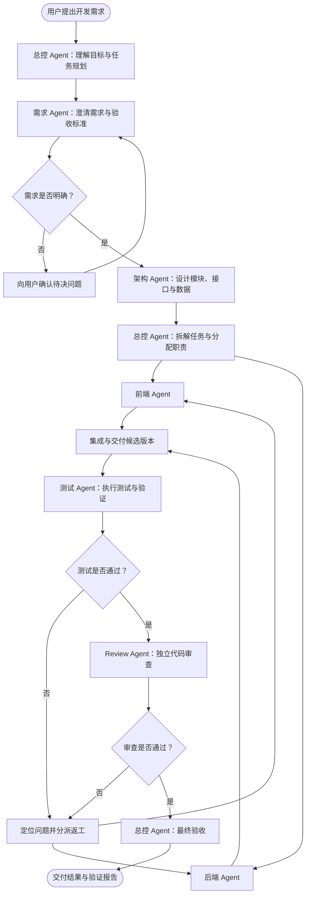
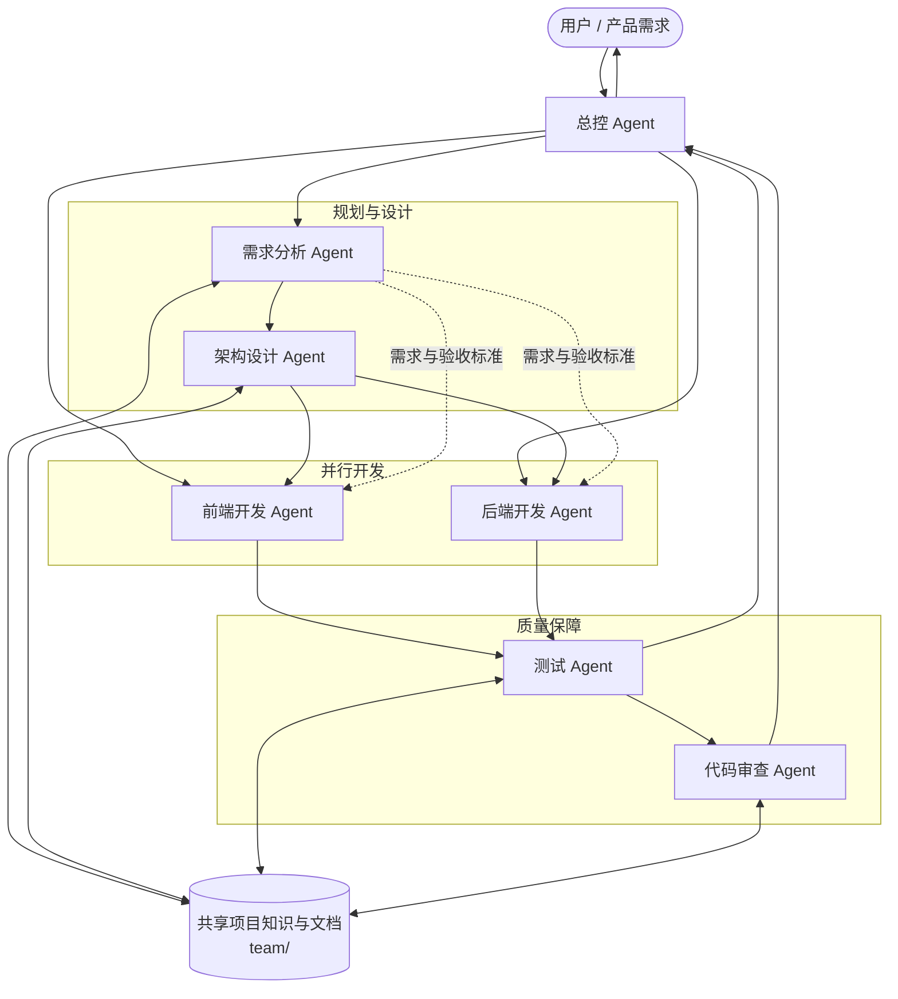
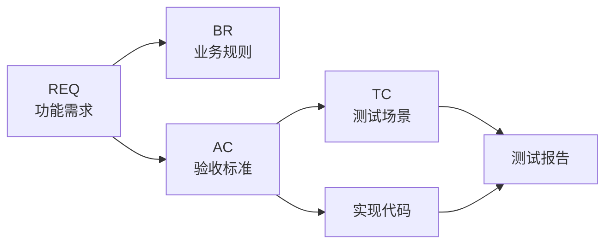

# Agent Forge

**面向 AI Agent 的全栈研发协作框架**

让 AI 从「单点代码生成」走向「团队式软件研发」。

Agent Forge 是一个基于 Vite Plus + pnpm Monorepo 构建的 AI 全栈研发框架。它尝试将传统软件工程中的需求分析、架构设计、前后端开发、测试验证与代码审查拆分为不同的 Agent 角色，通过明确的职责边界、任务依赖、需求追踪和质量门禁，组织多个 AI Agent 协同完成软件研发任务。

项目不仅关注代码如何生成，更关注需求如何被理解、任务如何被分配、不同角色如何协作，以及最终交付如何被验证。

> **核心理念：让 Agent 像一支真正的软件研发团队一样工作，而不只是让多个模型同时写代码。**

---

## 核心特性

### 1. 多 Agent 角色协作

将软件研发过程拆分为六种专业角色，每个 Agent 通过独立的 Skill 定义职责、工作流程、交付标准与行为边界。

| Agent 角色     | Skill               | 核心职责                                         |
| -------------- | ------------------- | ------------------------------------------------ |
| 总控 Agent     | 项目级协作规范      | 理解目标、组建团队、任务分配、进度协调与最终验收 |
| 需求分析 Agent | `role-requirements` | 需求澄清、验收标准、需求追踪与变更管理           |
| 架构设计 Agent | `role-architecture` | 模块划分、技术方案、接口契约与数据设计           |
| 前端开发 Agent | `role-frontend`     | 页面、组件、交互、状态管理与接口集成             |
| 后端开发 Agent | `role-backend`      | API、业务逻辑、权限、数据访问与后端测试          |
| 测试 Agent     | `role-testing`      | 测试场景设计、测试执行、结果记录与风险报告       |
| 代码审查 Agent | `role-review`       | 独立审查实现、正确性、安全性、兼容性与测试证据   |

每个角色都有明确的职责边界：

- 需求 Agent 不擅自决定技术架构。
- 架构 Agent 不代替开发 Agent 编写业务实现。
- 前后端 Agent 遵循已确认的接口契约。
- 测试 Agent 独立验证需求，不以代码实现代替验收。
- Review Agent 不审查自己编写的代码。
- 总控 Agent 负责协调冲突，并根据验证证据决定是否验收。

这种方式可以降低多 Agent 协作中的职责重叠、上下文混乱和结果缺乏验证等问题。

### 2. 团队式研发工作流

Agent Forge 将软件研发组织为一个可追踪的闭环：



**工作流程说明：**

1. 需求理解：总控 Agent 分析目标、范围、约束和潜在风险。
2. 需求确认：需求 Agent 整理需求正文、业务规则和验收标准。
3. 架构设计：涉及跨模块、接口、数据或重大技术决策时，由架构 Agent 输出设计方案。
4. 任务拆解：总控 Agent 根据依赖关系、修改范围和交付标准分配任务。
5. 并行开发：前端与后端在接口契约明确、依赖满足且修改范围不冲突时并行工作。
6. 测试验证：测试 Agent 根据验收标准执行必要测试。
7. 独立审查：Review Agent 检查实现质量、潜在风险与测试证据。
8. 最终验收：总控 Agent 汇总交付物和验证结果，更新任务状态并向用户交付。

简单任务可以合并部分阶段，但不能跳过必要的验证。

### 3. Agent 团队协作关系

不同 Agent 并不是简单地依次执行，而是围绕共享的需求、架构契约和交付物进行协作。



其中：

- 需求和验收标准是开发与测试的共同依据。
- 架构设计和接口契约约束前后端的协作边界。
- `team/` 用于沉淀跨任务共享的正式资料。
- 任务负责人、依赖、进度和阻塞状态由运行时任务板管理。
- 测试与审查结果作为最终验收的证据。

### 4. 结构化需求与变更追踪

为了避免 Agent 在长流程中丢失上下文，项目采用统一的编号体系，将需求、实现和测试关联起来。

| 标识  | 含义                | 用途         |
| ----- | ------------------- | ------------ |
| `REQ` | Requirement         | 功能需求     |
| `BR`  | Business Rule       | 业务规则     |
| `AC`  | Acceptance Criteria | 验收标准     |
| `CHG` | Change              | 需求变更记录 |
| `TC`  | Test Case           | 测试场景     |

示例追踪关系：



通过这种关联关系，可以回答：

- 某项功能来自哪条需求？
- 需求变更影响了哪些业务规则和验收标准？
- 某个实现对应哪些验收标准？
- 哪些测试场景验证了这些标准？
- 当前交付是否有实际测试证据？

需求正文是需求事实源，索引负责定位，变更日志记录决策与影响，测试报告记录实际执行结果。

### 5. Skills 驱动的角色规范

项目将不同 Agent 的专业知识和行为约束拆分为独立 Skill。

```text
.dsh/
└── skills/
    ├── role-requirements/
    │   ├── SKILL.md
    │   └── references/
    ├── role-architecture/
    │   ├── SKILL.md
    │   └── references/
    ├── role-frontend/
    │   ├── SKILL.md
    │   └── references/
    ├── role-backend/
    │   ├── SKILL.md
    │   └── references/
    ├── role-testing/
    │   ├── SKILL.md
    │   └── references/
    └── role-review/
        ├── SKILL.md
        └── references/
```

每个 Skill 不仅描述角色身份，还定义：

- 什么时候应该调用该角色。
- 开始工作前需要读取哪些上下文。
- 具体执行步骤和职责边界。
- 需要遵循的开发或文档规范。
- 应该向总控 Agent 提交哪些交付物。
- 什么条件下才能认为任务完成。

通过将角色规则与具体任务分离，可以减少重复提示词，并让不同任务复用相同的协作约定。

### 6. 工程化质量门禁

Agent 的工作不能以“代码已经生成”作为完成标准。

项目强调基于真实证据进行交付：

- 需求和验收标准必须明确。
- 实现需要符合架构与接口契约。
- 适用的测试和工程检查需要实际执行。
- 高风险变更需要独立代码审查。
- 失败项、未执行项和遗留风险必须如实说明。
- 阻断性门禁未通过时，不得将任务标记为完成。

---

## 技术栈

| 分类         | 技术                              |
| ------------ | --------------------------------- |
| Monorepo     | pnpm Workspace                    |
| 工程工具链   | Vite Plus                         |
| 语言         | TypeScript                        |
| 前端工程     | Vite + TypeScript                 |
| 后端框架     | NestJS                            |
| HTTP Adapter | Fastify                           |
| ORM          | TypeORM                           |
| 数据库       | PostgreSQL                        |
| 参数校验     | Joi、class-validator              |
| 日志         | Winston                           |
| 测试         | Vite Plus Test / 项目现有测试配置 |

### 工程结构

```text
agent-forge/
├── apps/
│   ├── website/             # 前端应用
│   └── backend/             # NestJS 后端服务
│       └── src/
│           ├── common/      # 公共能力
│           ├── config/      # 配置与环境变量校验
│           ├── infrastructure/
│           │   ├── database/
│           │   ├── logger/
│           │   └── observe/
│           └── modules/
│               ├── health/
│               └── iam/
│                   ├── auth/
│                   ├── profile/
│                   └── user/
│
├── packages/                # 可复用内部包
├── tools/                   # 工程工具
│
├── .dsh/
│   └── skills/               # Agent 角色 Skills
│
├── team/
│   ├── requirements/         # 需求正文、索引与变更记录
│   ├── architecture/         # 架构设计、接口契约与技术决策
│   ├── testing/
│   │   ├── plans/            # 测试计划
│   │   └── reports/          # 测试报告
│   └── reviews/              # 代码审查报告
│
├── AGENTS.md                 # 项目级 Agent 协作约定
├── package.json
├── pnpm-workspace.yaml
├── vite.config.ts
└── README.md
```

---

## 快速开始

### 环境要求

- Node.js `>= 22.18.0`
- pnpm `12.14.0`
- PostgreSQL

项目通过 `pnpm-workspace.yaml` 管理 Monorepo，并通过 `package.json` 中的 `devEngines` 声明包管理器要求。

### 1. 克隆项目

```bash
git clone https://github.com/CoKoii/agent-forge.git

cd agent-forge
```

### 2. 安装依赖

```bash
pnpm install
```

### 3. 配置环境变量

后端通过 Joi 校验运行环境配置。以下是根据当前配置定义整理的示例，实际使用时请替换为自己的数据库信息。

```dotenv
NODE_ENV=development
PORT=3000
LOG_LEVEL=info
CORS_ORIGIN=*

DB_HOST=localhost
DB_PORT=5432
DB_USERNAME=postgres
DB_PASSWORD=your_password
DB_DATABASE=agent_forge
DB_POOL_MAX=10

OBSERVE_APP_KEY=
OBSERVE_APP_SECRET=
```

将配置保存到仓库根目录的 `.env` 文件中。

### 4. 启动开发环境

```bash
pnpm dev
```

根目录脚本会并行启动 `website` 和 `backend` 两个工作区的开发服务。

### 5. 工程检查

```bash
# 代码检查
pnpm run check

# 执行测试
pnpm run test

# 构建所有工作区
pnpm run build

# 执行完整检查流程
pnpm run ready
```

`ready` 会依次执行检查、测试和构建。

---

## 开发约定

### 需求先行

开发任务应先明确目标、范围和验收标准。产品行为不明确时，先向用户确认，不通过猜测补齐产品决策。

### 契约优先

涉及前后端协作、数据结构或跨模块依赖时，优先确认接口契约和数据边界，再进行并行开发。

### 并行但不冲突

多个 Agent 可以并行工作，但需要明确：

- 每个任务的唯一负责人。
- 修改文件与模块范围。
- 任务之间的依赖关系。
- 共享接口和资源的所有权。
- 每项任务的交付物与验收标准。

### 独立验证

执行者报告完成不等于任务验收通过。测试与审查应尽量由不同角色独立完成，并保留真实验证证据。

### 知识沉淀

跨任务需要复用的正式资料统一保存在 `team/`；源码和可执行测试仍然保留在各自项目目录中。

---

## 项目状态

Agent Forge 正在持续开发中。

目前仓库已经包含：

- pnpm + Vite Plus Monorepo 工程结构。
- NestJS + Fastify 后端基础工程。
- PostgreSQL / TypeORM 数据访问基础设施。
- 配置校验、日志、限流及基础模块组织。
- 六类 Agent 的角色 Skill 与协作规范。
- 需求、架构、测试和审查文档管理约定。

以下部分仍在持续完善：

- 前端应用目前仍以初始模板为基础。
- 后端业务模块和认证流程仍需继续完善。
- Agent 角色规范与实际运行时的调度、任务状态管理能力，需要结合具体 Agent 宿主环境使用和验证。
- 自动化研发流程、团队可视化与更完整的交付闭环仍有进一步建设空间。

**本项目当前更侧重于建立可复用的 Agent 协作规范与全栈工程基础，而不是宣称已经实现完整的自动化 AI 研发平台。**

---

## Roadmap

- [x] pnpm Monorepo 工程结构
- [x] Vite Plus 工程工具链
- [x] NestJS 后端基础架构
- [x] Agent 角色职责与 Skill 规范
- [x] 需求追踪与团队文档组织规范
- [x] 测试与代码审查工作规范
- [ ] 完善前端应用
- [ ] 完善用户认证与权限体系
- [ ] 统一 Agent 任务状态与交付协议
- [ ] 深化多 Agent 自动调度与协作
- [ ] 完善需求、代码、测试之间的自动化追踪
- [ ] 建设研发过程可视化能力
- [ ] 完善端到端自动化验证流程

---

## Design Philosophy

Agent Forge 希望探索一种更工程化的 AI 软件研发模式：

**从 Prompt 到 Workflow，从单 Agent 到 Agent Team，从代码生成到可验证交付。**

AI Agent 不应该只是一个能够生成代码的工具。

它还应该理解需求、遵循架构、承担职责、协同工作、验证结果，并对最终交付负责。

---

## License

License 待补充。

## Author

**CoKoii**

GitHub: https://github.com/CoKoii
